<!--
Nộp bài: đổi tên file khi xuất PDF theo đúng quy định trong docs/HD-BTL-CV.pdf:
  CV_Project_title_1_<MSSV>_<HoTen>.pdf   (bài cá nhân)
  CV_Project_title_1_[<MSSV>_<HoTen>+]+.pdf   (bài nhóm, lặp lại cho từng thành viên)

Điền các mục [TODO: ...] bên dưới trước khi xuất PDF (khuyến khích dùng Pandoc/LaTeX,
xem README.md). Phần lý thuyết, pipeline và nhận xét kỹ thuật đã được soạn dựa trên
kết quả thực nghiệm thực tế trong outputs/ -- hãy đọc, kiểm chứng lại bằng cách tự
chạy code, và diễn đạt lại theo cách hiểu của bạn trước khi nộp (theo đúng lưu ý về
sử dụng AI trong docs/HD-BTL-CV.pdf).
-->

# Biểu diễn ảnh màu, lọc tín hiệu và biến đổi hình học

**Môn học:** [TODO: tên môn học]
**Sinh viên / Nhóm:** [TODO: Họ tên] — MSSV: [TODO]
**Repository (public):** [TODO: link GitHub/GitLab]
**Ngày nộp:** [TODO]

---

## 2.1. Mô tả bài toán & mục tiêu

Bài tập giải quyết ba bài toán con trong xử lý ảnh số:

1. **Biểu diễn ảnh màu và ảnh xám:** hiểu mối quan hệ giữa ảnh RGB và ảnh xám, vai trò
   của từng kênh màu trong việc tạo và tái tạo ảnh màu.
2. **Lọc tín hiệu trong không gian ảnh:** áp dụng low-pass filter (làm trơn, giảm
   nhiễu) và high-pass filter (làm nổi biên, chi tiết) bằng các kernel chuẩn.
3. **Biến đổi hình học:** hiện thực và so sánh translation, rotation, scaling, affine
   transformation, và projective (homography) transformation.

- **Input:** ảnh số RGB (hoặc ảnh xám), 8-bit mỗi kênh.
- **Output:** ảnh đã qua xử lý (chuyển kênh, lọc, biến đổi hình học) cùng các so sánh
  trực quan trước/sau.
- **Phạm vi & giả định:** ảnh tĩnh, không có yêu cầu thời gian thực; nhiễu được mô
  phỏng bằng nhiễu Gauss cộng vào ảnh sạch để có một trường hợp kiểm thử "ảnh nhiễu"
  có thể tái lập được (xem mục 2.3). Ảnh sử dụng là các ảnh mẫu chuẩn của thư viện
  `scikit-image` (public-domain, dùng phổ biến trong tài liệu Computer Vision) để đảm
  bảo tuân thủ bản quyền và để kết quả có thể tái lập 100% mà không cần tải ảnh ngoài.

## 2.2. Cơ sở lý thuyết

### Chuyển đổi ảnh màu <-> ảnh xám

Ảnh màu RGB tại mỗi điểm ảnh là một vector 3 chiều $(R, G, B)$. Ảnh xám là một chiếu
(projection) mất thông tin (lossy) từ 3 chiều xuống 1 chiều cường độ sáng. Công thức
luminosity (ITU-R BT.601) dùng trong project:

$$ Y = 0.299\,R + 0.587\,G + 0.114\,B $$

Trọng số không đều vì mắt người nhạy với ánh sáng xanh lá nhất, kém nhạy với xanh
dương nhất — nếu lấy trung bình cộng đơn giản $(R+G+B)/3$ sẽ cho ảnh xám *không* khớp
với độ sáng cảm nhận của mắt người. Vì phép chiếu này không khả nghịch (nhiều bộ
$(R,G,B)$ khác nhau có thể cho cùng $Y$), chiều "ngược lại" (xám -> màu) chỉ có thể
lặp lại giá trị $Y$ vào cả ba kênh ($R=G=B=Y$) — đây không phải là khôi phục màu gốc,
chỉ là biểu diễn lại giá trị xám dưới dạng ảnh 3 kênh.

### Kênh màu (color channels)

Tách kênh: $R = I[:,:,0]$, $G = I[:,:,1]$, $B = I[:,:,2]$. Ghép lại
$I' = \text{stack}(R,G,B)$ là phép nghịch đảo chính xác (lossless) của phép tách —
không có thông tin nào bị mất khi tách/ghép, khác với phép chiếu sang ảnh xám ở trên.

### Lọc ảnh trong không gian (convolution)

$$ g(x,y) = \sum_{i,j} f(x-i,\,y-j)\; k(i,j) $$

- **Low-pass (mean, Gaussian):** kernel có tổng = 1, trọng số dương, có tác dụng lấy
  trung bình cục bộ -> làm mượt/nhòe ảnh, giảm nhiễu tần số cao nhưng cũng làm mất chi
  tiết/biên. Gaussian có trọng số giảm dần theo khoảng cách tới tâm (thay vì đều như
  mean) nên giữ biên tốt hơn mean filter ở cùng kích thước kernel.
- **High-pass (Laplacian, Sobel):** kernel có tổng ≈ 0, nhạy với *biến thiên* cường độ
  -> làm nổi biên/chi tiết nhưng khuếch đại nhiễu (vì nhiễu cũng là biến thiên cường độ
  tần số cao). Laplacian là đạo hàm bậc 2 đẳng hướng (không phân biệt hướng biên);
  Sobel là đạo hàm bậc 1 theo từng hướng x, y, kết hợp thành độ lớn gradient
  $\sqrt{S_x^2+S_y^2}$, cho biên có hướng rõ hơn.

### Biến đổi hình học

**Affine** (6 bậc tự do, ma trận $2\times3$):

$$ \begin{bmatrix}x'\\y'\end{bmatrix} = \begin{bmatrix}a_{11}&a_{12}\\a_{21}&a_{22}\end{bmatrix}\begin{bmatrix}x\\y\end{bmatrix} + \begin{bmatrix}t_x\\t_y\end{bmatrix} $$

Bảo toàn tính song song và tỉ lệ khoảng cách trên một đường thẳng. Translation,
rotation, scaling đều là các trường hợp đặc biệt của affine. Xác định duy nhất bởi 3
cặp điểm tương ứng không thẳng hàng.

**Projective / homography** (8 bậc tự do, ma trận $3\times3$, toạ độ thuần nhất):

$$ \begin{bmatrix}x'\\y'\\w'\end{bmatrix} = H\begin{bmatrix}x\\y\\1\end{bmatrix},\qquad (x_{img},y_{img}) = \left(\frac{x'}{w'}, \frac{y'}{w'}\right) $$

Hàng thứ ba của $H$ (phép chia phối cảnh) cho phép mô hình hoá hiệu ứng phối cảnh
(perspective) — đường thẳng song song trong không gian 3D có thể hội tụ về điểm tụ
(vanishing point) trên ảnh 2D. Xác định bởi 4 cặp điểm tương ứng.

## 2.3. Hiện thực (Implementation)

**Pipeline tổng thể:** `load ảnh mẫu -> xử lý (Part 1 / 2 / 3) -> lưu figure so sánh
trước/sau vào outputs/`. Toàn bộ code trong `src/`, có thể chạy độc lập từng phần
(`python src/part1_color_channels.py`, ...) hoặc chạy tuần tự trong
`notebooks/CV_Project_1.ipynb`. Code đầy đủ: xem repository ở link đầu báo cáo; README
có hướng dẫn cài đặt và chạy.

**Đoạn code cốt lõi — chuyển đổi xám (Part 1):**

```python
def rgb_to_gray_manual(img_rgb):
    r, g, b = img_rgb[...,0].astype(np.float32), img_rgb[...,1].astype(np.float32), img_rgb[...,2].astype(np.float32)
    gray = 0.299 * r + 0.587 * g + 0.114 * b
    return np.clip(gray, 0, 255).astype(np.uint8)
```

**Đoạn code cốt lõi — low/high-pass filter (Part 2):**

```python
def gaussian_filter(img, ksize=5, sigma=1.5):
    return cv2.GaussianBlur(img, (ksize, ksize), sigma)

def sobel_filter(gray):
    sx = cv2.Sobel(gray, cv2.CV_64F, 1, 0, ksize=3)
    sy = cv2.Sobel(gray, cv2.CV_64F, 0, 1, ksize=3)
    mag = np.sqrt(sx**2 + sy**2)
    return np.clip(mag / mag.max() * 255, 0, 255).astype(np.uint8)
```

**Đoạn code cốt lõi — affine vs. projective (Part 3):**

```python
M_affine = cv2.getAffineTransform(src_3pts, dst_3pts)          # 2x3
warped_affine = cv2.warpAffine(img, M_affine, (w, h))

H = cv2.getPerspectiveTransform(src_4pts, dst_4pts)             # 3x3
warped_proj = cv2.warpPerspective(img, H, (w, h))
```

## 2.4. Kết quả thực nghiệm

### Part 1 — Kênh màu và ảnh xám

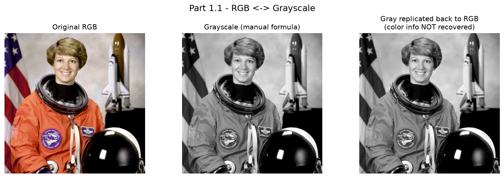
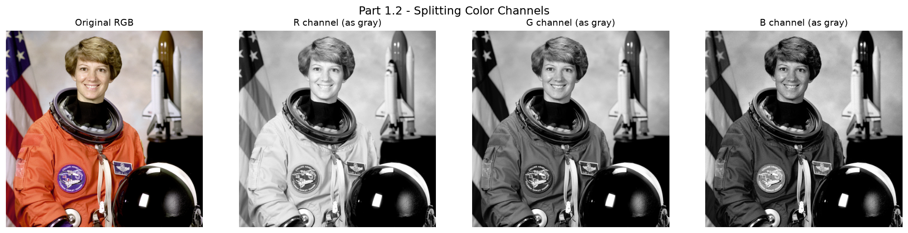
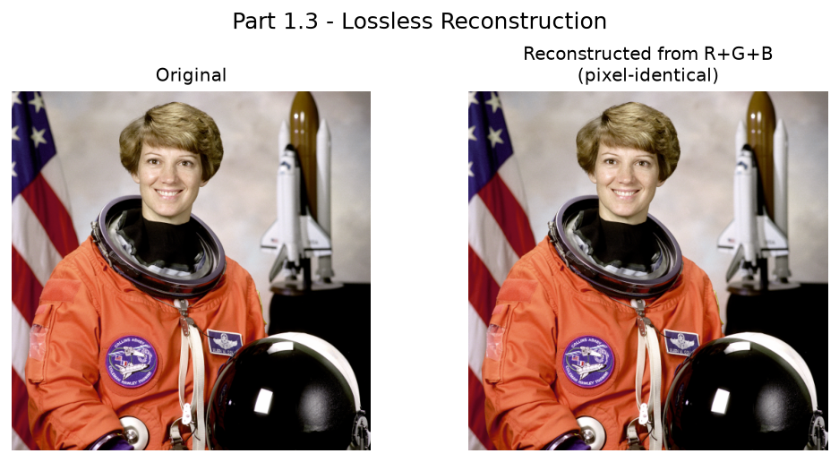
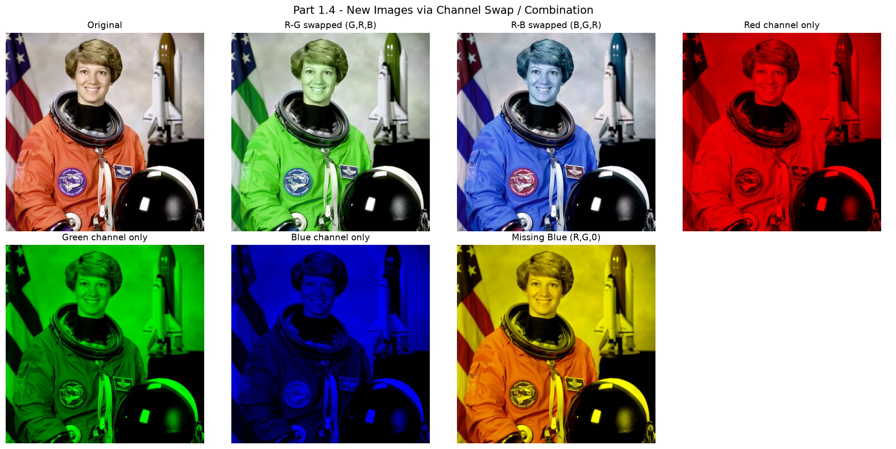

Kiểm chứng định lượng: sai lệch lớn nhất giữa công thức thủ công và `cv2.cvtColor`
là **≤ 1** mức xám trên toàn ảnh (chỉ do làm tròn số), và ảnh ghép lại từ 3 kênh
**giống hệt (pixel-identical)** ảnh gốc — xác nhận tách/ghép kênh là lossless còn
chuyển sang xám là lossy.

### Part 2 — Low-pass / High-pass filtering

Áp dụng trên 3 ảnh có đặc điểm khác nhau: `checkerboard` (biên sắc nét, ít chi tiết),
`coins` (nhiều chi tiết/kết cấu), `astronaut + nhiễu Gauss σ=25` (ảnh màu có nhiễu).

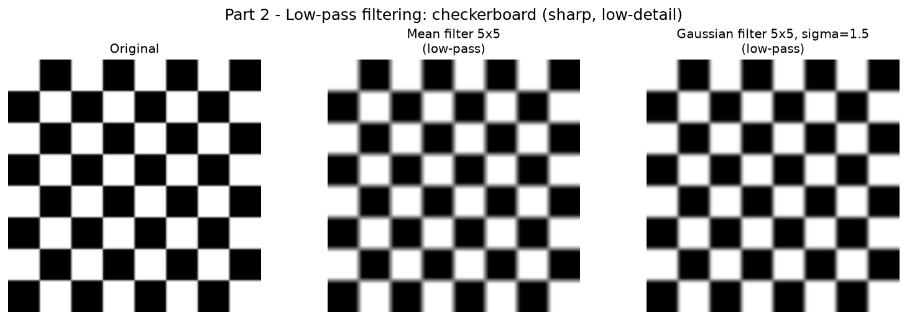
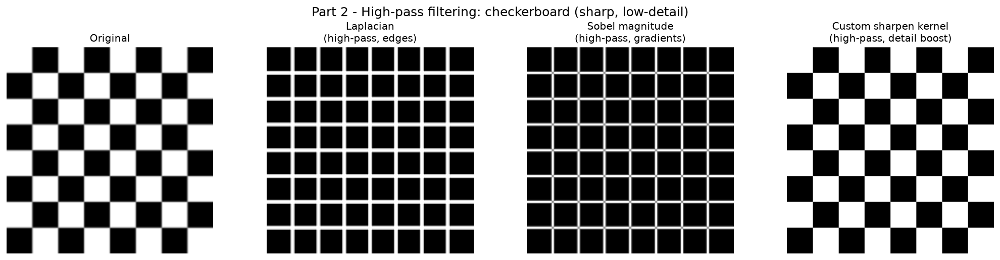
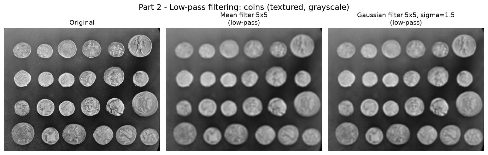
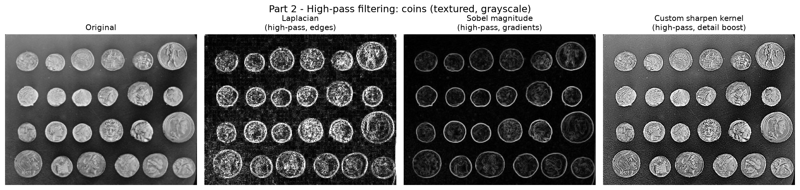
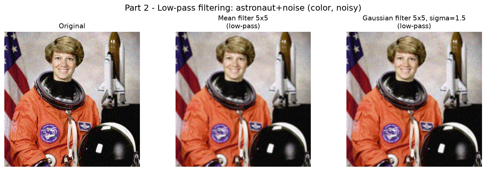
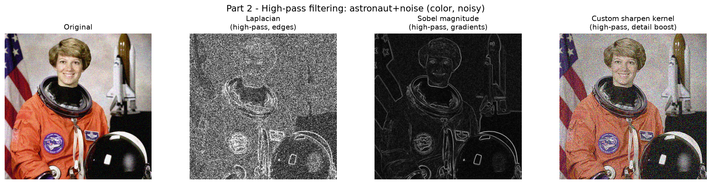

**Chỉ số định lượng** (độ lệch chuẩn của phần dư tần số cao — proxy cho mức nhiễu,
càng thấp càng "mượt"):

| Ảnh | Gốc | Sau mean 5x5 | Sau Gaussian 5x5 |
|---|---:|---:|---:|
| checkerboard | 44.70 | 28.51 | 31.44 |
| coins | 20.19 | 9.97 | 11.28 |
| astronaut + noise | 23.19 | 10.47 | 11.66 |

### Part 3 — Biến đổi hình học

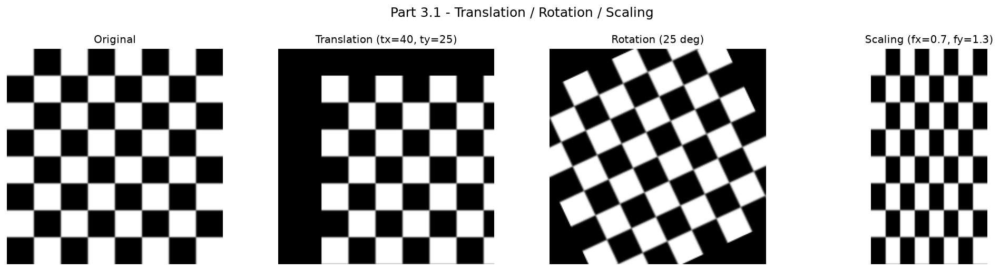
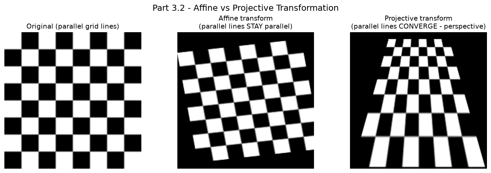
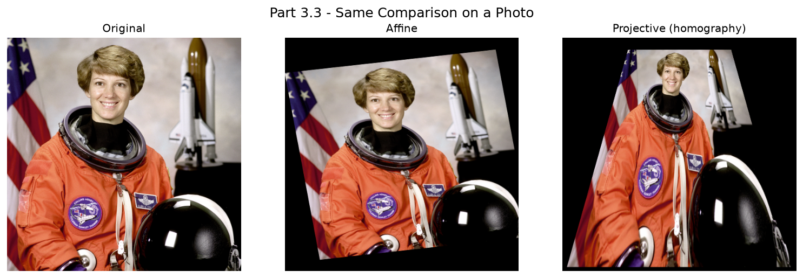

## 2.5. Nhận xét và thảo luận

**Part 1.** Kênh R/G/B khi hiển thị dưới dạng ảnh xám cho thấy mỗi kênh mang thông
tin khác nhau tuỳ màu vật thể tại điểm ảnh đó (ví dụ bộ đồ du hành màu cam sáng ở kênh
R, tối hơn ở kênh B). Hoán đổi R<->B làm đổi tông ấm/lạnh của ảnh vì đã đổi chỗ hiển
thị giữa hai dải bước sóng; xoá một kênh (gán 0) làm mất vĩnh viễn thông tin kênh đó,
không thể khôi phục từ hai kênh còn lại.

**Part 2.** Chỉ số nhiễu giảm khoảng một nửa sau lọc low-pass trên cả 3 ảnh, xác nhận
hiệu quả làm mượt/giảm nhiễu; tuy nhiên **cái giá phải trả khác nhau tuỳ ảnh**: với
`checkerboard` (biên sắc, ít chi tiết), việc làm mượt làm biên bị bo tròn/nhoè rõ rệt
bằng mắt thường; với `coins` (đã có biên mềm/kết cấu tự nhiên), tổn thất cảm nhận về
chất lượng thấp hơn dù chỉ số nhiễu giảm tương đương. High-pass filter (Laplacian,
Sobel) triệt tiêu vùng phẳng về gần đen và chỉ sáng lên tại vùng có tương phản cao —
kể cả tương phản đó là biên thật hay là hạt nhiễu — nên ảnh `astronaut + nhiễu` sau
high-pass filter cho kết quả biên bị "nhiễu hạt" nhiều hơn so với ảnh sạch, cho thấy
high-pass rất nhạy với nhiễu và nên áp dụng sau khi đã khử nhiễu nếu mục tiêu là trích
biên sạch.

**Part 3.** Trên ảnh `checkerboard`, kết quả affine là một lưới hình bình hành bị xén
— các đường ngang/dọc vốn song song ở ảnh gốc **vẫn song song** sau biến đổi. Kết quả
projective giống hiệu ứng "con đường xa dần": các đường vốn thẳng đứng **hội tụ** về
một điểm tụ phía trên ảnh. Đây là khác biệt thực dụng cốt lõi: **affine phù hợp khi
camera/mặt phẳng ảnh không đổi góc nhìn** (dịch chuyển trong mặt phẳng, xoay, co giãn,
xén hình do rung máy nhẹ), còn **projective/homography cần thiết khi có thay đổi góc
nhìn thật sự hoặc chỉnh ảnh một mặt phẳng chụp nghiêng** (ví dụ: chỉnh ảnh chụp tài
liệu/bảng chụp xiên góc — ứng dụng "document scanning"/rectification). Hạn chế của
affine là *không* mô hình hoá được phối cảnh, nên nếu áp dụng affine cho một cảnh có
phối cảnh thật, kết quả sẽ méo dạng thay vì đúng phối cảnh mong muốn; hạn chế của
projective là dễ nhạy với nhiễu ở các điểm tương ứng (sai số nhỏ ở toạ độ điểm có thể
khuếch đại thành méo hình lớn ở vùng xa tâm ảnh) và không xác định nếu 4 điểm gần
thẳng hàng.

## 2.6. Kết luận và hướng phát triển

Project đã hiện thực và minh hoạ trực quan: (1) quan hệ ảnh màu – ảnh xám – kênh màu
và tính lossy/lossless của từng phép biến đổi; (2) vai trò bổ sung của low-pass
(giảm nhiễu, đánh đổi chi tiết) và high-pass (làm nổi biên, đánh đổi độ nhạy nhiễu);
(3) khác biệt định tính rõ ràng giữa affine (bảo toàn song song) và projective (mô
hình phối cảnh) qua ví dụ lưới ô vuông.

Hướng mở rộng: (a) định lượng chất lượng lọc bằng PSNR/SSIM so với ảnh sạch gốc thay
vì chỉ dùng proxy độ lệch chuẩn; (b) thử denoising nâng cao hơn (bilateral filter,
non-local means) để so sánh khả năng giữ biên khi giảm nhiễu; (c) ước lượng homography
tự động từ các điểm đặc trưng khớp cặp (ORB/SIFT + RANSAC) thay vì chọn điểm thủ công,
để áp dụng vào bài toán thực tế như ghép ảnh panorama hoặc chỉnh ảnh tài liệu chụp
nghiêng.

[TODO: nếu là bài nhóm, thêm bảng phân công công việc từng thành viên theo hướng dẫn của môn học.]
